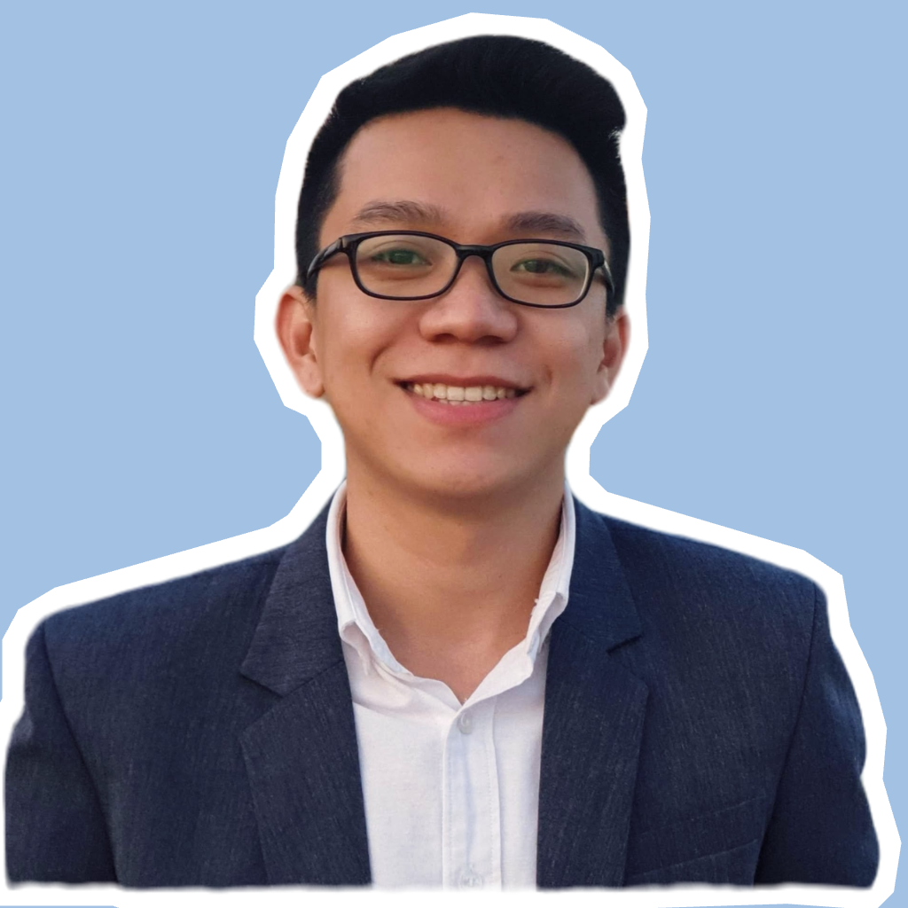

## About me

<strong> Welcome to my profile! </strong> 

::: {.grid}
::: {.g-col-4}

:::

::: {.g-col-8}
Hello, I'm <strong>Kieu Dang</strong>  
🎓 PhD Candidate in Information Science, Cybersecurity. 
🏫 State University of New York at Albany (SUNY Albany) 
📍 New York, USA  

🔬 **Research Interests**:  
- Trustworthy Machine Learning and AI  
- Privacy-Preserving Machine Learning  
- Adversarial Robustness and Watermarking

:::
:::

## Education

🎓 **PhD Candidate in Information Science**, State University of New York at Albany, USA (Aug 2024 – Present)   
  - Cumulative GPA: 4.00/4.00 Highest GPA in Cohort.  
  - Research Focus: Trustworthy Machine Learning and AI through the lens of Privacy and Security.

🎓 **Master in Analytics, Applied Machine Intelligence**, Northeastern University, USA (Aug 2021 – Jul 2023)  
  - Cumulative GPA: 4.00/4.00 - Valedictorian.   
  - Thesis: Improving Safety through the Integration of Multi-sensor Fusion and Deep Learning-based Object Detection.

## Research Overview

My research explores the intersection of **Trustworthy AI** and **Privacy-Preserving Technologies**, aiming to develop mechanisms that enhance the **security**, **privacy**, and **robustness** of large language models. I collaborate with industry and academic partners to deploy and evaluate adversarial robustness, watermarking techniques, and privacy-preserving frameworks in real-world AI systems.

## Recent Updates
🎉 **11/2026**: Our paper *LLM Watermarking as Big Data Provenance: A Deployment-Oriented Systematization* has been accepted at **IEEE BigData 2026** (PSBD 2026). 
🚀 **11/2026**: New paper release: *Adaptive Co-Serving LLM Watermarking on Modern Inference Engines* (SWIFT), in collaboration with IBM Research. 
📜 **10/2026**: Filed a new non-provisional US patent: *SWIFT Watermark Technique on Inference Engines*. 
🎤 **09/2026**: Presented at the South Colonie AI Superintendent's Conference Day. 
🏆 **11/2025**: Our proposal “Scalable Watermarking for LLM Outputs: IP Protection and Attribution on AIU Spyre” was selected as a 2025 CEAIS Seed Grant awardee (IBM Center for Emerging Artificial Intelligence Systems). 
📜 **10/2025**: My watermark patent is accepted on October 8, 2025. 
🎉 **09/2025**: I am happy to share that my research paper *$\delta$-STEAL: LLM Stealing Attack with Local Differential Privacy* has been accepted at **ACML 2025**. 
🚀 **Summer 2025**: Mentoring 6 undergraduate students on **LLM Watermarking** at SUNY Albany.  
🏆 **04/2025**: Received **Second Prize** for Best Poster at NTIR 2025.   

## Quick Links

🔬 [Research](/research/index.html)  
🎓 [Academic Experience](/academic.html)  
💼 [Professional Experience](/professional.html)  
🛠️ [Practical Projects](/projects.html)  
📝 [Blog](/blog/index.html)  
📄 [CV](/cv.pdf)

## Contact  
📧 [vdang@albany.edu](mailto:vdang@albany.edu)   
📰 [Medium](https://medium.com/@kirudang)   
🧑‍💻 [GitHub](https://github.com/kirudang)   
🎓 [Google Scholar](https://scholar.google.com/citations?hl=en&user=QOjXeq4AAAAJ)

Thank you!
